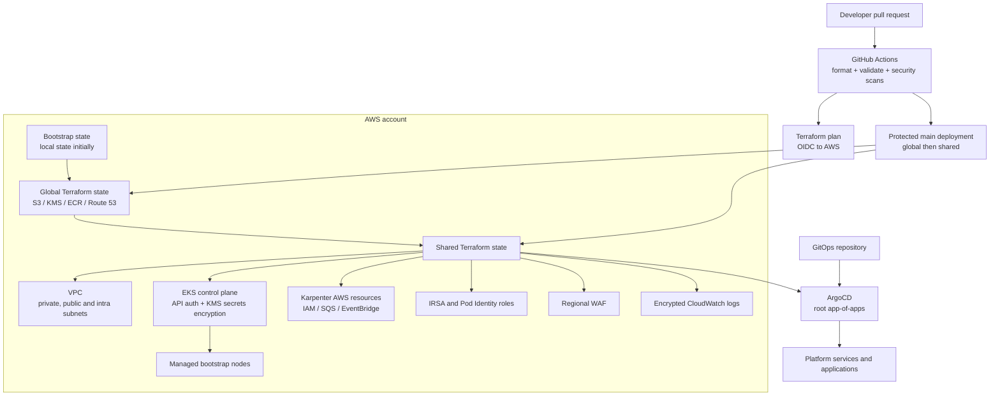

# EKS Platform Infrastructure

Production-minded AWS and Kubernetes infrastructure built with Terraform. This
repository is designed to demonstrate practical EKS, cloud security, GitOps,
infrastructure-as-code, and DevSecOps skills.

The key design decision is a clean ownership boundary:

- Terraform owns AWS networking, EKS, IAM, KMS, ECR, Route 53, WAF, observability
  primitives, Karpenter AWS resources, and the initial ArgoCD installation.
- ArgoCD owns the day-2 Kubernetes platform and applications from a separate
  GitOps repository.
- GitHub Actions validates and scans changes before Terraform plans or applies
  infrastructure.

## Architecture



### Terraform ownership layers

| Layer | State | Responsibility |
| --- | --- | --- |
| `bootstrap` | Local initially | Creates the encrypted remote state foundation and CI IAM/OIDC integration. This is a one-time human-operated step. |
| `global` | Remote S3 | Account-wide KMS keys, ECR repositories, Route 53 hosted zone, and shared outputs. |
| `shared` | Remote S3 | VPC, EKS, managed bootstrap node group, Karpenter AWS resources, controller IAM roles, logs, WAF, Velero bucket, and ArgoCD bootstrap. |
| GitOps repository | Git + ArgoCD | Kubernetes platform addons, policies, namespaces, workloads, ingress, NodePools, and application releases. |

`shared` reads the outputs from `global` through Terraform remote state. The
normal promotion order is therefore:

```text
bootstrap  ->  global  ->  shared  ->  ArgoCD-managed platform and applications
```

## What this provisions

- A three-AZ VPC layout with private, public, and intra subnets.
- EKS with API-based authentication, private endpoint access, configurable
  public endpoint CIDRs, KMS envelope encryption, and control-plane logging.
- Core EKS addons: CoreDNS, kube-proxy, VPC CNI, EKS Pod Identity Agent, and
  the EBS CSI driver.
- A small managed node group for bootstrap-critical workloads. Karpenter then
  provides the AWS-side resources for workload capacity managed by GitOps.
- Scoped IAM roles for the AWS Load Balancer Controller, external-dns,
  cert-manager, External Secrets, Fluent Bit, Velero, and EBS CSI.
- KMS-encrypted CloudWatch log groups and a KMS-encrypted, versioned Velero S3
  backup bucket.
- A regional WAF web ACL whose ARN is consumed by the GitOps ingress layer.
- ECR repositories with scan-on-push and lifecycle settings.
- A one-time ArgoCD Helm installation and root app-of-apps handoff.

This repository intentionally does not install the full platform through
Terraform. Istio, Prometheus, cert-manager, External Secrets, Velero, the AWS
Load Balancer Controller, external-dns, Karpenter NodePools, and applications
belong in the GitOps repository.

## Repository layout

```text
.
├── .github/workflows/terraform.yml  # CI, security scans, plan and apply
├── ci/Dockerfile                    # Optional baked CI image
├── ci/install-tools.sh              # AWS CLI, Terraform, jq and build tools
├── infra-terraform/
│   ├── bootstrap/                    # One-time state and CI foundation
│   ├── global/                      # Account-wide resources
│   ├── environments/shared/         # EKS platform composition
│   ├── modules/                     # VPC, EKS, IAM, Karpenter, WAF, etc.
│   ├── projects/                    # Per-project variables and backend config
│   └── Makefile                     # Consistent Terraform entry point
├── docs/                            # Design, connectivity and incident notes
├── SECURITY.md                      # Security controls and reporting process
└── README.md
```

The Terraform roots are project-agnostic. A new deployment is created by
copying `infra-terraform/projects/_template/` and supplying project-specific
values in `common.tfvars`, `bootstrap.tfvars`, `global.tfvars`, `shared.tfvars`,
and `backend.hcl`.

## DevSecOps pipeline

The GitHub Actions workflow is deliberately visible and auditable:

1. Terraform formatting, initialization, and validation run on pull requests,
   pushes to `main`, and manual runs.
2. Checkov scans Terraform and the GitHub Actions workflow for misconfiguration.
3. Trivy scans the repository for high/critical IaC and secret findings.
4. Gitleaks scans the complete Git history for committed secrets.
5. SARIF results are uploaded to GitHub Code Scanning when repository permissions
   allow it.
6. Pull requests receive read-only Terraform plans when they originate from the
   repository. Fork pull requests receive static security scans but do not get
   AWS credentials.
7. A merge to `main` applies `global`, then `shared`. The `global` and `shared`
   GitHub environments can require reviewer approval before deployment.

See [SECURITY.md](SECURITY.md) for the security control summary.

## Prerequisites

- Terraform `>= 1.9`.
- AWS CLI v2.
- An AWS account and an operator role with permission to perform the bootstrap.
- A registered domain if Route 53 DNS is required.
- A GitOps repository URL and a read-only deploy key for ArgoCD if the GitOps
  repository is private.

Terraform and upstream modules are version constrained. The main provider and
module versions are documented in [infra-terraform/README.md](infra-terraform/README.md)
and the root version reference at [infra-terraform/versions.tf](infra-terraform/versions.tf).

## First-time setup

1. Copy the project template:

   ```bash
   cp -R infra-terraform/projects/_template infra-terraform/projects/my-project
   ```

2. Fill in the project files. Keep credentials, private keys, and generated
   state out of Git.

3. Run the bootstrap root locally. It creates the state bucket, KMS key, and
   CI integration needed by the later roots:

   ```bash
   make -C infra-terraform init PROJECT=my-project ROOT=bootstrap
   make -C infra-terraform apply PROJECT=my-project ROOT=bootstrap
   make -C infra-terraform output PROJECT=my-project ROOT=bootstrap
   ```

4. Put the generated backend settings into
   `infra-terraform/projects/my-project/backend.hcl`.

5. Apply the account-wide and cluster layers in order:

   ```bash
   make -C infra-terraform init PROJECT=my-project ROOT=global
   make -C infra-terraform apply PROJECT=my-project ROOT=global

   make -C infra-terraform init PROJECT=my-project ROOT=shared
   make -C infra-terraform apply PROJECT=my-project ROOT=shared
   ```

6. Confirm that ArgoCD can reach the GitOps repository and that the root
   application begins reconciliation.

## GitHub Actions configuration

Configure these repository-level values in GitHub:

| Type | Name | Purpose |
| --- | --- | --- |
| Variable | `PROJECT` | Folder name under `infra-terraform/projects/`. |
| Variable | `AWS_REGION` | AWS deployment region. |
| Secret | `CI_ROLE_ARN` | AWS role assumed through GitHub OIDC. |
| Secret | `GITOPS_SSH_PRIVATE_KEY` | Base64-encoded ArgoCD deploy key. |

Create protected GitHub environments named `global` and `shared`. Add required
reviewers to `shared` if cluster changes should require an explicit approval.

The AWS trust policy must allow the GitHub Actions OIDC provider and restrict
the `sub` claim to this repository and its intended branch/environment. The
existing Terraform bootstrap code contains Bitbucket-oriented OIDC history, so
the trust policy must be reviewed or updated before relying on GitHub Actions
for AWS access.

## Important security hardening before publishing

The repository includes scanners and documentation, but scans do not replace
correct environment values. Before presenting this as production-ready:

- Replace the sample EKS API CIDR `0.0.0.0/0` in the project variables with
  office, VPN, or runner egress CIDRs. Disable public endpoint access entirely
  when private connectivity is available.
- Review the VPC NAT configuration. The current module code sets
  `single_nat_gateway = true`, while its comments describe one NAT gateway per
  AZ. Choose deliberately based on the availability and cost trade-off.
- Scope the CI role to the resources managed by this repository instead of
  relying on broad wildcard permissions.
- Enable GitHub branch protection and require the quality/security gate and
  Terraform plan checks before merge.
- Never commit the ArgoCD private key, AWS credentials, Terraform state, or
  real account-specific secrets.

The outstanding hardening items are tracked in
[docs/improvement-plan.md](docs/improvement-plan.md).

## Outputs consumed by GitOps

The `shared` root exports the interfaces needed by the GitOps repository:

- Cluster name, endpoint, region, and OIDC provider ARN.
- IAM role ARNs for the AWS Load Balancer Controller, external-dns,
  cert-manager, External Secrets, Fluent Bit, Velero, and EBS CSI.
- Karpenter controller and node role ARNs, interruption queue, and instance
  profile.
- CloudWatch log group names, WAF ARN, Route 53 zone details, and ECR URLs.

This output contract keeps infrastructure provisioning and Kubernetes workload
delivery independently deployable.

## Validation commands

```bash
make -C infra-terraform fmt-check

terraform -chdir=infra-terraform/bootstrap init -backend=false
terraform -chdir=infra-terraform/bootstrap validate

terraform -chdir=infra-terraform/global init -backend=false
terraform -chdir=infra-terraform/global validate

terraform -chdir=infra-terraform/environments/shared init -backend=false
terraform -chdir=infra-terraform/environments/shared validate
```

For the complete operational notes, apply order, variables, outputs, and
provider details, see [infra-terraform/README.md](infra-terraform/README.md).
